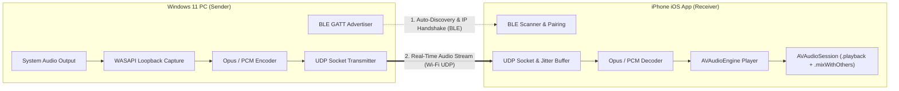
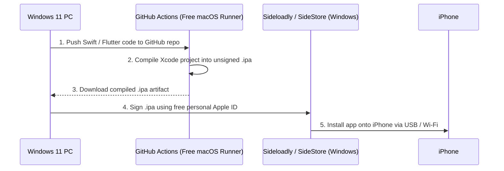

# PC-to-iPhone Real-Time Audio Streamer
**Low-Latency Wireless Audio Bridge with Background Execution & Native iOS Audio Mixing**

---

## 1. Executive Summary & Problem Statement

Streaming system audio from a **Windows 11 PC** to an **iPhone** so the iPhone acts as a wireless audio receiver presents three major technical challenges:

1. **iOS Bluetooth Profile Lock:** Apple strictly restricts the iOS Bluetooth stack to act only as an **A2DP Source** (sending audio to headphones/speakers) and disables **A2DP Sink** (receiving audio from external devices like a PC). Furthermore, Bluetooth Low Energy (BLE) lacks the bandwidth required for real-time, high-fidelity audio streaming.
2. **Background Playback Persistence:** The audio stream must continue playing uninterrupted when the iPhone screen is locked or when the user switches to other applications.
3. **Non-Interruptive Audio Mixing:** Incoming PC audio must play **simultaneously** alongside native iPhone audio (e.g., TikTok, YouTube, mobile games, phone notifications) without pausing or muting the iPhone's active media apps.

> [!IMPORTANT]
> Because iOS Safari (Web Audio / HTML5 Audio) enforces exclusive audio session locks and cannot configure native `AVAudioSession` mixing flags, a **Native iOS App** paired with a **Windows 11 Desktop App** is required to achieve seamless background audio mixing.

---

## 2. Proposed Solution Overview

Instead of relying on classic Bluetooth A2DP, the system uses a **Hybrid BLE + Local Wi-Fi (UDP) Architecture** (similar to how Apple AirDrop operates):

* **Bluetooth Low Energy (BLE) / mDNS for Discovery & Handshake:** The Windows 11 app advertises its presence and network parameters over BLE. The iPhone detects the PC automatically via Bluetooth for one-tap pairing—no manual IP entry required.
* **Wi-Fi (LAN) / USB NCM for Low-Latency Audio Transport:** Once paired via BLE, real-time compressed audio (Opus or raw PCM) is streamed over UDP on the local Wi-Fi network (or over a lightning/USB-C cable), achieving ultra-low latency (`10ms – 25ms`) and superior audio quality compared to Bluetooth.
* **Native iOS `AVAudioSession` Mixing:** The iOS client uses `AVAudioSession.Category.playback` combined with the `.mixWithOthers` option and Background Audio permissions so PC audio blends seamlessly into the iPhone's audio output.

---

## 3. System Architecture



---

## 4. Core Component Breakdown

### 4.1. Windows 11 Desktop Application (Audio Transmitter)
* **Audio Capture (`WASAPI Loopback`):** Captures the exact digital audio stream being sent to the Windows default playback device (or a virtual audio cable) in real time with zero degradation.
* **Encoding (`Opus Codec`):** Compresses raw PCM audio (`48kHz, 16-bit/float, Stereo`) into tiny Opus frames (`2.5ms` to `10ms` frame size). Opus keeps network bandwidth under `128–256 kbps` while maintaining near-lossless quality and sub-20ms latency.
* **BLE Peripheral Server (`Windows.Devices.Bluetooth.Advertisement`):** Broadcasts a custom BLE GATT service containing the PC's local IP address, active UDP port, and pairing token.
* **Network Transport (`UDP`):** Sends sequenced audio packets to the connected iPhone IP address.

### 4.2. iOS Native Application (Audio Receiver & Mixer)
* **BLE Central Client (`CoreBluetooth`):** Passively scans for the Windows 11 PC's BLE advertisement, reads the connection endpoint, and initiates the stream.
* **Audio Session Configuration (`AVFoundation`):**
  ```swift
  import AVFoundation

  func configureMixedBackgroundAudio() throws {
      let session = AVAudioSession.sharedInstance()
      try session.setCategory(
          .playback,
          mode: .default,
          options: [.mixWithOthers] // Prevents muting/pausing other iPhone apps
      )
      try session.setPreferredIOBufferDuration(0.005) // ~5ms low-latency buffer
      try session.setActive(true)
  }
  ```
* **Background Execution (`Info.plist`):**
  ```xml
  <key>UIBackgroundModes</key>
  <array>
      <string>audio</string>
      <string>bluetooth-central</string>
  </array>
  ```
* **Audio Rendering (`AVAudioEngine` + `AVAudioPlayerNode`):** Receives decoded PCM buffers from a small adaptive jitter buffer and schedules them continuously on the audio engine so iOS keeps the background audio thread alive indefinitely.

> [!TIP]
> You can also offer an optional **"Duck Others"** toggle (`.duckOthers`) in the iOS app UI, which slightly lowers PC audio volume whenever a phone call or notification arrives, or lowers iPhone media volume when PC audio peaks.

---

## 5. Audio Packet Protocol Design (UDP)

To prevent audio glitches over Wi-Fi while keeping latency minimal, each UDP datagram uses a compact 12-byte header:

| Byte Offset | Field | Size | Description |
| :--- | :--- | :--- | :--- |
| `0 - 1` | Magic Header | 2 Bytes | `0x41 0x53` ("AS" - Audio Stream) |
| `2 - 3` | Sequence Number | 2 Bytes | `uint16` rolling packet counter for drop/reorder detection |
| `4 - 7` | Timestamp | 4 Bytes | `uint32` sample timestamp (`48kHz` clock) |
| `8` | Codec & Channels | 1 Byte | Bitmask (`0x01` = Raw PCM, `0x02` = Opus; Stereo/Mono) |
| `9 - 10` | Payload Length | 2 Bytes | `uint16` length of audio frame in bytes |
| `11` | Flags | 1 Byte | Heartbeat / Keep-alive / Volume sync flags |
| `12+` | Audio Payload | Variable | Encoded Opus frame or raw PCM samples |

---

## 6. Recommended Tech Stack

| Layer | Option A (Recommended - Best Performance) | Option B (Cross-Platform Unified) |
| :--- | :--- | :--- |
| **Windows 11 App** | **C# (.NET 8 + WPF/WinUI 3)** with `NAudio` (WASAPI) + `Concentus` (Opus) | **Rust + Tauri** (`cpal` for WASAPI + `opus`) |
| **iOS App** | **Swift (SwiftUI)** with native `AVAudioEngine` & `CoreBluetooth` | **Flutter** with native Swift MethodChannel for `AVAudioSession` |
| **Discovery** | Windows WinRT BLE Advertiser + iOS `CoreBluetooth` | mDNS (Bonjour / Zeroconf) + BLE fallback |
| **Transport** | Raw UDP over Local Wi-Fi (or USB Tethering) | WebRTC Data/Audio Channel |

---

## 7. Building & Installing the iOS App Using Only a Windows 11 PC

Because Apple requires macOS and Xcode to compile iOS binaries, you can build and deploy this app entirely for free from Windows 11 using the following workflow:



> [!NOTE]
> With **SideStore** installed on the iPhone, the app automatically refreshes its free 7-day Apple certificate over Wi-Fi in the background, meaning you never have to reconnect the iPhone to the PC to re-sign it.

---

## 8. Implementation Roadmap

1. **Phase 1 — Core Audio Streaming Prototype (UDP):**
   * Build the Windows 11 console/tray app to capture WASAPI Loopback audio and broadcast UDP PCM/Opus packets.
   * Build the Swift iOS app with `AVAudioSession` (`.playback` + `.mixWithOthers`) to receive and play the UDP stream in the background.
2. **Phase 2 — Automated GitHub Actions CI Build:**
   * Configure `.github/workflows/ios-build.yml` so pushing code from Windows 11 automatically produces a downloadable `.ipa` file.
3. **Phase 3 — Bluetooth (BLE) Auto-Discovery & Pairing:**
   * Add BLE GATT advertising on Windows 11 and `CoreBluetooth` scanning on iOS so connecting requires zero IP configuration.
4. **Phase 4 — UI Polish & Controls:**
   * Add independent volume sliders, latency buffer control (`5ms` – `50ms`), and silent keep-alive packets (so iOS does not suspend the background app when the PC is temporarily silent).
